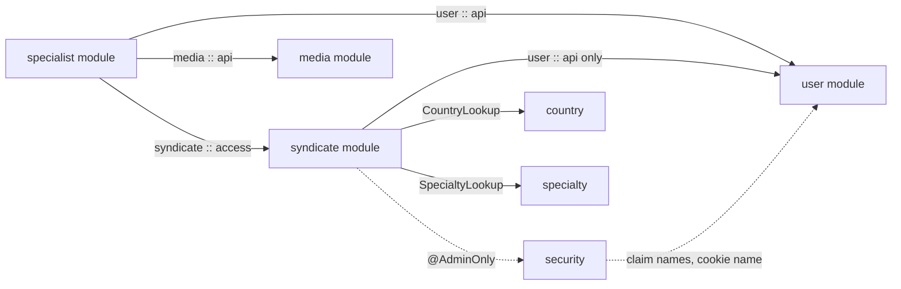
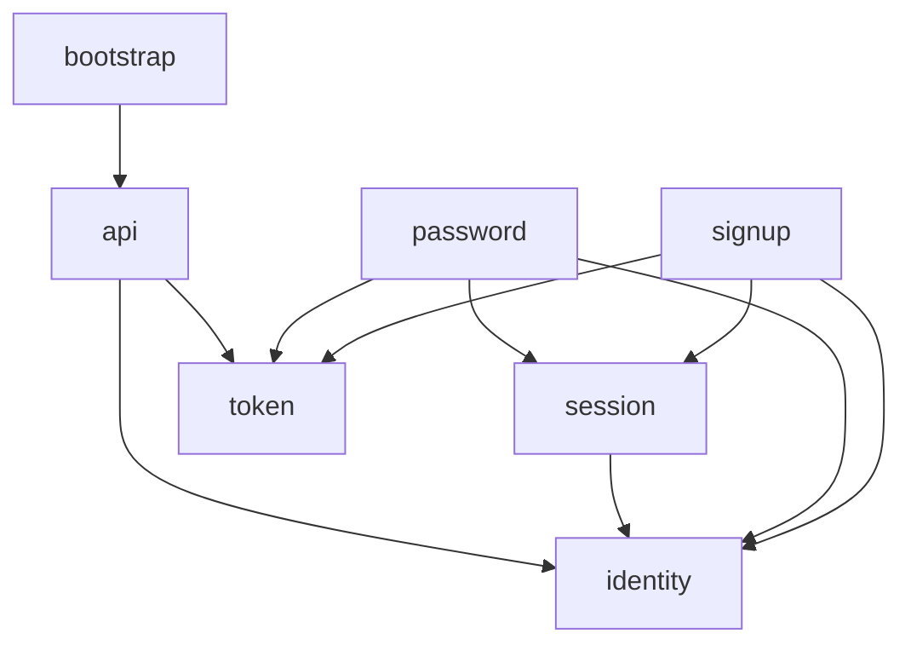

# Package-by-feature architecture

How the Nemouw backend is organized, which packages may depend on which, and what is public on purpose.

## 1. The idea

Code is grouped by **feature**, not by technical layer. Everything a feature needs (controller, service, repository, DTOs, domain types) lives in one package, so a change to a feature touches one place.

Two rules keep the boundaries real:

- **Package-private by default.** A class or method is `public` only when code in another package uses it. The compiler then enforces the boundaries.
- **Modules where it matters.** The four largest features, `user`, `syndicate`, `specialist` and `media`, are Spring Modulith application modules. `ModularityTests` fails the build if a module reaches into another module's internals.

## 2. Layout

```
com.nemouw
├── user                 module: accounts, sign-up, login, sessions
│   ├── identity         users, email identifiers, password hashing and policy
│   ├── session          login, refresh, logout, JWTs, cookies
│   ├── signup           3-step sign-up and the setup token
│   ├── password         forgot and reset password
│   ├── token            OTP and reset-link tokens, throttling
│   ├── bootstrap        the --create-user command (invites an account from the terminal)
│   └── api              what other modules may use (named interface "api")
├── syndicate            module: syndicates and their staff
│   ├── management       create, read and update syndicates
│   ├── staff            staff, owner and invites
│   └── access           @PreAuthorize rules (admin, owner, staff) (named interface "access")
├── specialist           module: specialist profiles and public discovery
│   ├── profile          the specialist itself: onboarding, username, review, verification status
│   ├── content          bio, title and headline per language
│   ├── location         clinic locations
│   ├── availability     weekly availability windows
│   ├── treatedcondition conditions a specialist treats
│   ├── credential       credentials, their documents and their review
│   ├── image            profile picture and cover image
│   ├── template         profile personalization (primary color)
│   └── discovery        public search, filters, sorting and the public profile
├── media                module: file storage
│   ├── api              what other modules may use (named interface "api")
│   ├── processing       image resize and WebP encoding, PDF validation
│   └── storage          S3 access, purge and reconcile jobs
├── country              reference data, one package
├── specialty            reference data, one package
├── condition            reference data, one package
├── security             filter chains, rate limiter, @AdminOnly
└── common               shared infrastructure, no feature logic
    └── config, enums, exception, mail, query, time, util, web
```

`user`, `syndicate`, `specialist` and `media` are modules (`spring.modulith.detection-strategy=explicitly-annotated`, and each has a `package-info.java` with `@ApplicationModule`). `country`, `specialty`, `condition`, `security` and `common` are plain packages.

## 3. Who may depend on whom



- `syndicate` declares `allowedDependencies = "user :: api"`. It can use `AccountService`, `InviteService`, `UserDirectory` and `UserSummary`, and nothing else in `user`.
- `specialist` uses `user :: api` (`AccountService`, in `SpecialistReviewService`), `media :: api` (to store and link pictures and credential documents) and `syndicate :: access` (the `@AdminOrSyndicateStaff` annotation on credential review). It does not declare `allowedDependencies` yet, so Modulith does not restrict it beyond the named interfaces.
- `user` and `media` depend on no other module. `syndicate` does not depend on `specialist`.
- Inside `syndicate`, `management` may use `staff` (through `SyndicateOwners` and `SyndicateStaffService`) and `access`, `staff` uses `access`, and `access` depends on neither.
- `common` depends on no feature.
- Reference data is exposed to other packages through a small `*Lookup` class (`CountryLookup.existsById`, `SpecialtyLookup`) instead of its repository or entity.
- The `security` package reads claim names and the cookie name from `user.session` (`TokenClaims`, `AuthCookies`).

Inside `user`, the sub-packages form a one-way chain:



`token` and `identity` depend on no sibling. `session` exposes `SessionService.issue` and `revokeAllForUser` so that sign-up and password reset can start and end sessions without touching `SessionRepository`.

Inside `specialist`, `profile` is the hub. `content`, `location`, `availability`, `treatedcondition`, `credential`, `image` and `template` each depend only on `profile` (for example `SpecialistLookup` and `@CurrentSpecialistId`), never on each other. `discovery` is read-only and depends on `availability` (weekday and time parsing).

Inside `media`, `api` is the only public surface. It uses `processing` and `storage`, which do not know each other.

## 4. What is public, and why

| Kind of class                                                                                                                 | Visibility                                      |
|-------------------------------------------------------------------------------------------------------------------------------|-------------------------------------------------|
| Services, repositories, assemblers, config, filters                                                                           | Package-private, constructors too               |
| Controllers and `*Dtos` holders                                                                                               | Public classes, package-private handler methods |
| JPA entities (`Country`, `Specialty`, `Condition`)                                                                            | Package-private classes, public accessors       |
| Types another package uses (`SessionService`, `UserRepository`, `VerificationTokens`, `PasswordHasher`, `CountryLookup`, ...) | Public, with only the methods that are used     |
| `user.api`, `media.api`                                                                                                       | Public: they are the modules' contracts         |

Methods and classes that stay `public` even though nothing outside their package calls them:

- `SyndicateAccess.isStaffOf` and `isOwnerOf`, `SpecialistReviewAccess.isReviewer` and `CredentialReviewAccess.isReviewer`: `@PreAuthorize` calls these beans by name through SpEL.
- Handler methods carrying `@AdminOnly`, `@AdminOrSyndicateOwner`, `@AdminOrSyndicateStaff`, `@AdminOrSpecialistReviewer` or `@AdminOrCredentialReviewer`: they are method-security proxied.
- `SyndicateStatus.code()`: it carries `@JsonValue`.

## 5. Conventions inside a feature

| Name                 | Role                                                                                                                           |
|----------------------|--------------------------------------------------------------------------------------------------------------------------------|
| `XController`        | HTTP only: parse, call the service, build the response                                                                         |
| `XService`           | Business rules and transactions                                                                                                |
| `XRepository`        | Data access. `JdbcClient` SQL in `user`, `syndicate`, `specialist` and `media`, Spring Data JPA in the reference-data packages |
| `XDtos`              | One holder class with nested request and response records                                                                      |
| `XLookup`, `api`     | The read-only or narrow surface a feature offers to others                                                                     |
| `XAssembler`, `XRow` | Turn repository rows into responses                                                                                            |
| `XFields`            | Shared field names and limits for a feature's input (`LocationFields`, `CredentialFields`, `AvailabilityFields`)               |
| `XAccess`            | A bean that answers a `@PreAuthorize` question that needs data (`SyndicateAccess`, `SpecialistReviewAccess`)                   |

A feature that needs something from another feature depends on a narrow type that the owner chose to expose, such as `SyndicateOwners` ("what management may ask of staff"), not on the owner's repository.

Shared infrastructure in `common`: `exception` (error codes and the global handler), `mail` (templates and the transport, `file` or `live`), `query` (the `filter[...]` and `sort` parser used by discovery), `time`, `util` (validation and text helpers) and `web` (trace id, request log, client IP).

Background work lives next to what it serves: `media.storage` holds `MediaPurgeJob` and `MediaReconcileJob`, both `@Scheduled` (scheduling is enabled in `NemouwBackendApplication`).

## 6. Tests

Tests mirror the main packages, so each test sits in the same package as the class it covers and can see its package-private members.

- Shared helpers live in `support` (`Fixtures`, `ShippedProperties`, which binds a properties record from the shipped `application.properties`).
- When a test needs a package-private type from another package, a public test helper sits next to that type: `TestPasswordHasher` (next to `PasswordConfig`), `Jwts` (next to `JwtConfig`) and `ImageFixtures` (next to the media processing tests).
- A test of a feature mocks the public collaborators of other features. For example, `SignupServiceTest` mocks `SessionService`, and `SessionServiceTest` covers real session issuing.
- `ModularityTests` checks the module boundaries. `NemouwBackendApplicationTests` loads the whole application, so it needs the env values and a database (see the [setup guide](../Setup.md)).

## 7. Adding a feature

1. Create a package under `com.nemouw` and keep everything package-private.
2. Make public only what another package needs, ideally as a `*Lookup` or an `api` package.
3. If it is large or has its own internals, add a `package-info.java` with `@ApplicationModule` and list its `allowedDependencies`.
4. Add its routes and roles to `SecurityConfig`. Routes without a rule are denied.
5. Add a Flyway migration for its tables.
6. Put its tests in the same package.