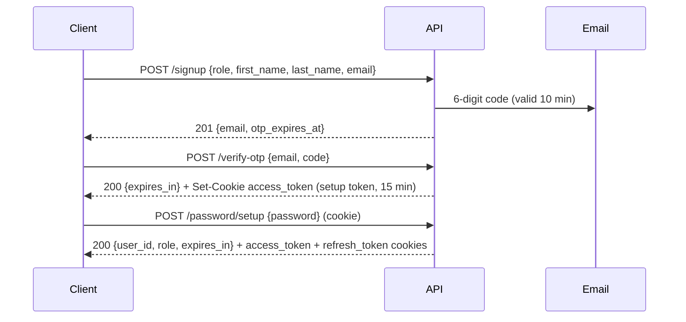
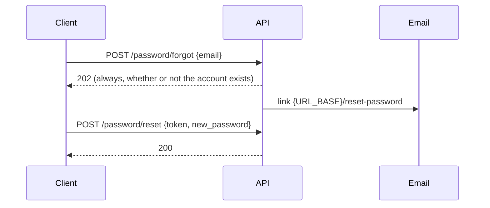

# Authentication

How sign-up, login, sessions and password reset work in the Nemouw backend, what the API contract is, and what protects it.

Base path: `/v1/auth`. JSON is `snake_case`. All state-changing calls are `POST`.

## 1. Design at a glance

- **Verify first, password later.** Sign-up collects name and email only. The user proves mailbox ownership with a 6-digit code, then chooses a password.
- **Tokens live in HttpOnly cookies only.** No token is ever returned in a response body, so frontend JavaScript cannot read or leak it.
- **Hybrid JWT + database sessions.** The access token is a short-lived signed JWT. Every request also checks that its session row is still live in PostgreSQL, so logout, password reset and suspension take effect immediately.
- **Rotating refresh tokens** with reuse detection.
- **Deny by default.** Anything that is not an explicit public auth route or an authenticated `/v1/**` route is rejected.

## 2. Flows

### 2.1 Sign-up (3 steps)

Details:

- Only the `specialist` role can self-register. Any other role returns `422 INVALID_ROLE`.
- The account is created as `pending`. It becomes `active` only when the password is set.
- Signing up again with an email that is still `pending` re-issues the code and overwrites the stored name (the person who owns the mailbox wins). An email that belongs to a non-pending account returns `409 EMAIL_TAKEN`.
- The setup token is **not a session**. It carries only the scope `password_setup`, and Spring Security accepts it on exactly one endpoint (`POST /password/setup`). It has no refresh token and cannot be renewed.
- The setup token is single use: setting the password flips the account from `pending` to `active` under a row lock, and the endpoint refuses anything that is not `pending`.

### 2.2 Login

`POST /login` with `identifier` (email today) and `password`. On success the API sets both cookies and returns `{user_id, role, expires_in}`.

- Unknown account, account without a password, wrong password and deleted account all return the same `401 INVALID_CREDENTIALS`, and a dummy Argon2 check runs so response time does not reveal which case it was.
- `403 ACCOUNT_SUSPENDED` and `403 ACCOUNT_NOT_VERIFIED` are returned only after the password was correct.

### 2.3 Refresh and logout

- `POST /refresh` has no body. The browser sends the `refresh_token` cookie. The token is rotated atomically: the old one stops working and a new pair of cookies is set.
- If a rotated-out token is replayed **after** a 10 second grace window, the whole session is revoked and `refresh_token_reuse` is logged (likely theft). Inside the window the call just fails with `401`, because it is probably two tabs racing.
- `POST /logout` has no body. It revokes the session in the database and clears both cookies. It always answers `204`, even with a missing or unknown token.

### 2.4 Password reset

- The token is 32 random bytes, valid 60 minutes, single use. It travels in the URL fragment (`#token=`), so it is not sent to servers or written to access logs.
- A successful reset **revokes every session** of that user.
- Suspended and deleted accounts get no email and the same `202`.
- A reset on a `pending` account activates it and marks the email verified (the link proves mailbox control).

## 3. Endpoints

| Method and path | Auth | Request body | Success |
|---|---|---|---|
| `POST /signup` | none | `role`, `first_name`, `last_name`, `email`, `locale?` | `201` `{email, otp_expires_at}` |
| `POST /verify-otp` | none | `email`, `code` | `200` `{expires_in}` + setup cookie |
| `POST /resend-otp` | none | `email`, `locale?` | `202`, empty (always, even for unknown emails) |
| `POST /password/setup` | setup cookie | `password` | `200` `{user_id, role, expires_in}` + session cookies |
| `POST /login` | none | `identifier`, `password` | `200` `{user_id, role, expires_in}` + session cookies |
| `POST /refresh` | refresh cookie | none | `200` `{user_id, role, expires_in}` + new cookies |
| `POST /logout` | refresh cookie (optional) | none | `204` + cookies cleared |
| `POST /password/forgot` | none | `email`, `locale?` | `202`, empty |
| `POST /password/reset` | none | `token`, `new_password` | `200`, empty |

Notes:

- `locale` is `en`, `fr` or `ar`. Anything else falls back to `en`.
- `expires_in` is in seconds (access token: 900, setup token: 900).
- Every other `/v1/**` endpoint requires a valid access cookie from a live session with one of the roles below.

Roles: `admin`, `patient`, `specialist`, `syndicate_staff`.

## 4. Cookies

| | `access_token` | `refresh_token` |
|---|---|---|
| Content | Signed JWT (session token, or setup token during sign-up) | 32 random bytes, base64url |
| Lifetime | 15 minutes (setup token: 15 minutes) | 90 days |
| `Path` | `/` | `/v1/auth` (never sent with ordinary API calls) |
| `SameSite` | `Lax` | `Strict` |
| `HttpOnly` | yes | yes |
| `Secure` | `COOKIE_SECURE` (must be `true` outside local HTTP) | same |

Frontend requirements:

- Send requests with credentials: `fetch(url, { credentials: 'include' })`, and serve the frontend from an origin listed in `CORS_ALLOWED_ORIGINS`.
- On `401 INVALID_TOKEN` for an API call, call `POST /refresh` **once**, then retry the original call. Make sure only one refresh is in flight at a time (queue the other callers behind it).
- If `/refresh` returns `401`, the session is over: send the user to login.

## 5. Tokens and sessions

**Access token (JWT, HS256).** Claims: `sub` (user id), `role`, `sid` (session id), `iat`, `exp`. Verified on every request: algorithm pinned to HS256, signature, expiry (zero clock skew), then a database check that the session is not revoked or expired **and** the user is `active`.

**Setup token (JWT, HS256).** Claims: `sub`, `scope=password_setup`, `iat`, `exp`. No `role` and no `sid`, so it matches no role rule and cannot reach any normal endpoint.

**Refresh token.** Stored only as a SHA-256 hash in `user_sessions`. Each rotation keeps the previous hash for reuse detection.

**`user_sessions`** also stores the device type, OS, browser, user agent (cut at 512 characters) and IP, for a future "your devices" screen.

## 6. Validation rules

| Field | Rule |
|---|---|
| `email` | Required, at most 254 characters, shape `x@y.z`. Trimmed and lowercased before use |
| `first_name`, `last_name` | Required, at most 100 characters (after trimming) |
| `role` | Must be `specialist` |
| `code` | Exactly 6 digits |
| `password` | 8 to 64 characters (counted as Unicode code points); not on the common-password blocklist (about 100k entries, also checked after removing non-letters and decoding leet such as `P@ssw0rd`); must not contain `nemouw` or the email local part (4+ characters). No mandatory uppercase / digit / symbol rules |

Passwords are hashed exactly as typed (no normalization) with **Argon2id** (19 MiB, 2 iterations, 1 lane, 16-byte salt, 32-byte hash), the OWASP minimum.

## 7. Throttling

Per email address, stored in the database (`user_verification_tokens`), so it survives restarts and works across instances.

| | Signup OTP | Password reset |
|---|---|---|
| Code / token lifetime | 10 min | 60 min |
| Wrong attempts allowed | 5 per issued code | not applicable (256-bit token) |
| Minimum gap between sends | 60 s | 60 s |
| Sends per window | 3 per 15 min | 3 per 60 min |
| Sends per day | 10 | 10 |

When throttled the API answers `429 TOO_MANY_REQUESTS` with a `Retry-After` header (seconds).

On top of that, an in-memory per-IP shield (`DDOS_SHIELD_REQUEST_LIMIT_PER_SECOND`, default 5) answers `429` with `Retry-After: 1`. It is per instance, so with several instances the effective limit multiplies. Stricter auth-specific limits are planned.

## 8. Error handling

Authentication endpoints follow the backend's standardized
error response format.

See [Error Handling](../errors/README.md) for response
schemas, HTTP status codes, error codes, and validation errors.

## 9. Security model

| Threat | Mitigation |
|---|---|
| Token theft by XSS | HttpOnly cookies, nothing in response bodies, tokens kept out of logs (`toString` overridden) |
| CSRF | No Spring CSRF filter, by design. `SameSite` cookies plus CORS: a cross-site browser request carries an `Origin` header that is rejected unless listed in `CORS_ALLOWED_ORIGINS`. The refresh cookie is `Strict` and scoped to `/v1/auth` |
| Algorithm confusion / `none` | Decoder pinned to HS256 |
| Stolen or replayed refresh token | Rotation, hashed storage, reuse detection with session revocation |
| Revoked session still usable | Live database check on every request |
| Account enumeration | Same response and timing for login failures, same `202` for forgot / resend, same `400` for OTP on unknown email. **Exception:** sign-up returns `409 EMAIL_TAKEN`, a deliberate product trade-off |
| OTP guessing | 5 attempts per code, increment and limit in one SQL statement, constant-time comparison, new code needs the cooldown and caps |
| Reset token leakage | HMAC-hashed at rest, URL fragment, single use, 60 min |
| Concurrent races (double set-password, double refresh, double reset) | Row locks and atomic `UPDATE` / `DELETE ... RETURNING` |
| SQL injection | Every query uses bound parameters |
| Weak or missing secrets | App refuses to start unless both secrets are at least 32 characters |
| Privilege escalation at sign-up | Role allow-list (`specialist` only) |
| Forged client IP | `X-Forwarded-For` is trusted only when `TRUST_PROXY=true` **and** the direct peer is a private or loopback address, and only the last entry is used |
| Oversized input | Field limits, 512 character user-agent cap |

Stored secrets: password hashes (Argon2id), refresh token hashes (SHA-256), OTP and reset token hashes (HMAC-SHA256 with `OTP_HASH_SECRET`).

## 10. Database tables

Created by `V2__identity_auth.sql` and `V6__session_rotation.sql`.

| Table | Purpose |
|---|---|
| `users` | Account, role, status (`pending`, `active`, `suspended`, `deleted`) |
| `user_identifiers` | Email (phone and username modeled, not used yet). Emails are stored lowercase, enforced by a check constraint |
| `user_passwords` | Argon2id hashes, one row per user |
| `user_verification_tokens` | One row per (identifier, purpose): hashed code, attempts, send counters |
| `user_sessions` | Hashed refresh token, previous hash, rotation time, revocation, device info |
| `user_social_accounts` | Reserved for social login |

## 11. Operations notes

- **Logging.** One `http_request` line per request (method, path, status, duration; no query string) and `user_id` / `trace_id` on every line. Emails log the recipient address and provider id, never the code or link.
- **Email failures.** Delivery runs on a 4-thread executor with a queue of 100 and 3 attempts (1 s and 4 s backoff). When it gives up it logs `EMAIL_UNDELIVERED`; the user can request a new code. If the queue is full the email is dropped and logged, not queued forever.
- **Cleanup.** Expired sessions and verification tokens are not deleted yet. Plan a scheduled purge.
- **Rotating `JWT_SECRET`** logs everyone out (all access tokens become invalid; refresh tokens still work and mint new ones).
- **Rotating `OTP_HASH_SECRET`** invalidates all outstanding codes and reset links.

## 12. Not implemented yet

Social login, phone and username login, per-account login lockout, "your devices" session list, password change while logged in, email change, durable email queue.